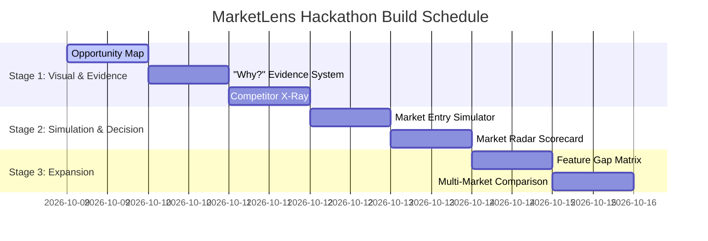

# 🚀 MarketLens — Feature Specification & Hackathon Roadmap
> **SerpApi India Hackathon 2026 — Track 4: Commerce & Market Intelligence**

---

## 📌 Executive Summary & Vision

**MarketLens** transforms live e-commerce search data (via SerpApi) into evidence-backed, actionable market intelligence for sellers, drop-shippers, and brand strategists.

Instead of providing a static dashboard, MarketLens functions as an **AI-powered market decision platform**. It allows sellers to visually identify unserved market gaps, inspect competitor strategies, simulate pricing scenarios in real time, and trace every AI conclusion back to empirical search data.

---

## 🎯 The Core Intelligence Principle

```
OBSERVED FACT ➔ DERIVED METRIC ➔ ANALYTICAL INTERPRETATION ➔ ACTIONABLE HYPOTHESIS
```

MarketLens never makes unverified business claims. Every insight presented to the user follows a strict evidence chain rooted in normalized, observed SerpApi data.

---

## ⭐️ Shortlisted Feature Breakdown & Benefits

---

### 1. 🗺️ Market Opportunity Map (Tier S)
* **Category**: Visual Intelligence & Whitespace Discovery
* **Tier**: `Tier S (Killer Differentiator)` — ⭐⭐⭐⭐⭐

#### 📝 Feature Brief
An interactive 2D Scatter Plot matrix plotting analyzed market products across key dimensions:
* **X-Axis**: Price ($\text{₹} / \$ / \text{€} / \text{£}$)
* **Y-Axis**: Customer Rating (1–5 Stars) or Review Density
* **Bubble Size**: Merchant Count or Review Volume

The system automatically highlights **"Opportunity Whitespaces"** — uncrowded price-quality regions where customer demand exists but competitor density is low.

#### 💡 Key Benefits
* **For Sellers**: Instantly identifies sweet spots for product launch without manual spreadsheet analysis.
* **For Hackathon Demo**: Provides an immediate visual "WOW" factor for judges within 5 seconds of running a scan.

---

### 2. 🧪 AI Market Entry & Price War Simulator (Tier S)
* **Category**: Interactive Financial & Positioning Decision Engine
* **Tier**: `Tier S (Killer Differentiator)` — ⭐⭐⭐⭐⭐

#### 📝 Feature Brief
An interactive scenario builder where sellers can test entering a market by tuning real-time sliders:
1. **Proposed Selling Price**
2. **Estimated Unit Cost (COGS)**
3. **Target Marketing Spend**
4. **Initial Inventory Volume**

As the seller drags the price slider:
* **Positioning Tier**: Recalculates dynamically (Budget $\rightarrow$ Mid-Tier $\rightarrow$ Premium).
* **Margin & Break-even**: Computes unit margin and minimum volume needed to break even.
* **Competitor Pressure**: Dynamically updates how many competing products exist at that exact price point ($\pm 10\%$).

#### 💡 Key Benefits
* **For Sellers**: Turns passive market data into active financial planning and pricing experimentation.
* **For Hackathon Demo**: Highly engaging interactive element — judges love dragging sliders to see real-time recalculations.

---

### 3. 🔬 Competitor X-Ray (Tier S)
* **Category**: Deep-Dive Competitor Profiling
* **Tier**: `Tier S (Killer Differentiator)` — ⭐⭐⭐⭐⭐

#### 📝 Feature Brief
Clicking on any product listing opens a dedicated **Competitor X-Ray** slide-over panel. This panel aggregates public SerpApi evidence into a structured profile:
* **Price Positioning**: Comparison vs. category median and average.
* **Rating & Traction Index**: Star rating, review count, and estimated review velocity.
* **Feature Spec Matrix**: Extracted specifications and value propositions.
* **Observed Strengths & Weaknesses**: Auto-extracted insights (e.g., *"High rating but limited delivery options"*).

#### 💡 Key Benefits
* **For Sellers**: Offers deep competitive teardowns using 100% public search data.
* **For Hackathon Demo**: Shows rich, contextual detail without overwhelming the primary view.

---

### 4. 🔍 MarketLens "Why?" Evidence System & Evidence Graph (Tier A)
* **Category**: AI Explainability & Auditability
* **Tier**: `Tier A (High-Impact Intelligence)` — ⭐⭐⭐⭐⭐

#### 📝 Feature Brief
Every AI-generated opportunity card or risk signal features an interactive **"Why?"** button. Clicking it opens an **Evidence Audit Modal**:
* Shows exact sample size ($N$ products analyzed).
* Displays price percentile statistics and merchant concentration ratios.
* Direct links to the exact SerpApi-harvested product listings supporting the claim.

#### 💡 Key Benefits
* **For Sellers**: Builds complete trust in AI recommendations by eliminating black-box "hallucinations".
* **For Hackathon Demo**: Directly aligns with SerpApi's hackathon criteria of evidence-backed market intelligence.

---

### 5. ⚔️ Feature Gap Detector ("Beat the Competition" Mode) (Tier A)
* **Category**: Differentiation Vector Analysis
* **Tier**: `Tier A (High-Impact Intelligence)` — ⭐⭐⭐⭐⭐

#### 📝 Feature Brief
Analyzes titles, snippets, and structured extensions across all listings to categorize product attributes into two groups:
1. **Table Stakes (>60% adoption)**: Mandatory baseline features (e.g., *"Free Delivery"*, *"1-Year Warranty"*).
2. **Differentiator Gaps (10%–30% adoption)**: Emerging attributes (e.g., *"Ergonomic Lumbar Support"*, *"Organic Fabric"*).

#### 💡 Key Benefits
* **For Sellers**: Gives actionable feature blueprints for product development to stand out against incumbent sellers.
* **For Hackathon Demo**: Translates raw text search snippets into clean, quantifiable product feature percentages.

---

### 6. 📡 Market Radar Scorecard (Tier A)
* **Category**: Executive Health Check
* **Tier**: `Tier A (High-Impact Intelligence)` — ⭐⭐⭐⭐

#### 📝 Feature Brief
A 5-axis Radar chart summarizing the overall health and viability of a market:
1. **Competition Density** (Product & merchant volume)
2. **Price Stability** (Price variance & cluster concentration)
3. **Rating Traction** (Customer satisfaction & review volume)
4. **Feature Gap Potential** (Unserved attribute opportunities)
5. **Evidence Confidence** (Data sample size & freshness)

#### 💡 Key Benefits
* **For Sellers**: At-a-glance scorecard to quickly judge whether a market is worth pursuing.
* **For Hackathon Demo**: Beautiful visual centerpiece on the scan dashboard.

---

### 7. 🔎 Search Intelligence & Query Expansion (Tier A)
* **Category**: Category & Niche Exploration
* **Tier**: `Tier A (High-Impact Intelligence)` — ⭐⭐⭐⭐⭐

#### 📝 Feature Brief
Leverages SerpApi Google Search related queries to automatically discover and cluster commercial search phrases (e.g., expanding *"Ergonomic Desk Chair"* $\rightarrow$ *"Ergonomic Desk Chair with Footrest"*, *"Mesh Gaming Chair"*).

#### 💡 Key Benefits
* **For Sellers**: Expands a single product concept into multiple niche sub-categories.
* **For Hackathon Demo**: Demonstrates powerful use of SerpApi's search graph capabilities.

---

### 8. 🌐 Multi-Market Regional Comparison (Tier A)
* **Category**: Cross-Border Arbitrage
* **Tier**: `Tier A (High-Impact Intelligence)` — ⭐⭐⭐⭐

#### 📝 Feature Brief
Allows sellers to compare the same category across multiple countries side-by-side (e.g., India vs. US vs. UK) comparing local pricing, top merchants, and opportunity scores.

#### 💡 Key Benefits
* **For Sellers**: Unlocks cross-border e-commerce and international expansion strategies.
* **For Hackathon Demo**: Highlights global SerpApi localization features (`gl`, `hl`, `currency`).

---

## 🏗️ Stage-by-Stage Implementation Roadmap



### 🏁 Stage 1: Visual Intelligence & Evidence Layer
> **Goal**: Add immediate visual impact and full evidence transparency.
1. **Market Opportunity Map Component**: Interactive Recharts Scatter plot with price/rating axes and whitespace overlays.
2. **"Why?" Evidence Modal System**: Audit trail UI attached to all opportunity cards.
3. **Competitor X-Ray Drawer**: Slide-over drawer for deep competitor listing inspection.

### ⚡ Stage 2: Interactive Decision Engine
> **Goal**: Enable interactive user simulation and executive scorecards.
4. **AI Market Entry & Price War Simulator**: Real-time slider controls with dynamic margin & tier recalculation.
5. **Market Radar Scorecard**: Recharts Radar visual scorecard component.

### 🌐 Stage 3: Advanced Intelligence & Expansion
> **Goal**: Deepen feature gap analysis and multi-region exploration.
6. **Feature Gap Detector**: Visual matrix of baseline vs. differentiator features.
7. **Query Expansion & Multi-Market View**: Related search term explorer & side-by-side regional comparison.

---

## 🏆 The 2-Minute Hackathon Demo Script

1. **0:00 - 0:20 | The Problem & Scan**: "Sellers lose thousands launching products without knowing market density. Let me search *'Ergonomic Desk Chair'* in MarketLens."
2. **0:20 - 0:45 | Opportunity Map & Radar**: "Instantly, MarketLens pulls SerpApi live commerce data. The **Market Radar** scores overall viability, while the **Opportunity Map** highlights this unserved whitespace at $\text{₹}4,500$ with 4.5+ stars."
3. **0:45 - 1:10 | Evidence & Competitor X-Ray**: "Every AI insight is 100% explainable — clicking **'Why?'** shows exact listing data. We can X-Ray top sellers to inspect their exact feature gaps."
4. **1:10 - 1:40 | Price War Simulator**: "Now, let me simulate launching at $\text{₹}4,999$. Watch the simulator recalculate our position, break-even unit volume, and competitive pressure in real time."
5. **1:40 - 2:00 | AI Briefing & Conclusion**: "Finally, we generate an evidence-backed AI report ready for export. MarketLens turns raw search data into confident market decisions."

---
*MarketLens • SerpApi India Hackathon 2026*
